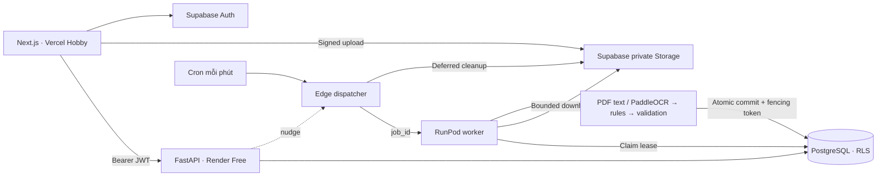

# SmartInvoice AI

Ứng dụng đọc hóa đơn Việt/Anh: upload → OCR/extraction → đối chiếu → chỉnh sửa/xác nhận → thống kê. Portfolio cho AI Application Engineer Intern.

**Hiện trạng 21/10/2026:** đã có frontend Next.js, API FastAPI, worker PaddleOCR, schema/RLS, transactional jobs/outbox, Edge dispatcher và cấu hình CI/container. Supabase Free `smartinvoice-ai` đã được tạo tại Singapore, áp dụng 4 migration. Luồng Auth/Storage/API/worker/database thật đã qua smoke test bằng PDF giả lập. OCR CPU cũng đã nhận dạng ảnh hóa đơn tiếng Việt tổng hợp. Chưa benchmark hóa đơn thực, chưa có URL production Vercel/Render/RunPod.

## Kiến trúc



Không dùng LLM bắt buộc, Redis hay Cloud Tasks. Database là nguồn trạng thái chính. Tiền dùng chuỗi decimal ở API và `NUMERIC` trong Postgres. MVP hỗ trợ VND, không cộng trực tiếp nhiều loại tiền tệ.

| Thành phần | Công nghệ | Nền tảng |
|---|---|---|
| Frontend | Next.js 16, React 19, TypeScript, Tailwind 4 | Vercel Hobby |
| API | FastAPI, Pydantic, httpx | Render Free |
| Auth/database/file | Supabase Auth/PostgreSQL/private Storage | Supabase Free |
| OCR | PaddleOCR 3, OpenCV, PyMuPDF, rules | RunPod credit hiện có |
| Queue | Transactional outbox, leases, Edge/Cron | Supabase |
| CI/image | GitHub Actions/GHCR | Trong quota miễn phí |

RunPod là compute tính phí theo sử dụng. Chỉ bật sau khi image đã build và đã chọn giới hạn: **0 active workers, tối đa 1 worker**, không tạo Pod chạy liên tục. Image hiện là Paddle CPU baseline; chưa đo GPU. Không tự nâng nền tảng sang gói trả phí. [Chi phí và nguồn chính thức](docs/free-deployment.md).

## Chạy local

Yêu cầu Python 3.11, uv, Node.js 22+. Có thể xem giao diện mẫu mà không cần tài khoản cloud hay model OCR.

```powershell
uv sync --frozen --group dev
npm ci
npm --prefix frontend ci
Copy-Item backend/.env.example backend/.env
Copy-Item frontend/.env.example frontend/.env.local
uv run uvicorn backend.app.main:app --host 127.0.0.1 --port 8000 --no-access-log
```

Terminal khác:

```powershell
npm --prefix frontend run dev
```

Mở `http://localhost:3000`, chọn **Xem không gian mẫu**. Đây là dữ liệu minh họa chỉ để xem giao diện, không phải kết quả AI thật. Swagger: `http://127.0.0.1:8000/docs`.

Để sử dụng dữ liệu thật, điền URL/publishable key Supabase vào frontend; secret/service-role key chỉ nằm ở backend/worker. Không ghi đè file env đã cấu hình. Git/Docker loại trừ file env thật. Không đưa secret vào `NEXT_PUBLIC_*`.

## Kiểm tra

```powershell
uv run ruff check backend worker scripts
uv run python scripts/export_contracts.py --check
uv run pytest -q
npm run test:db
npm --prefix frontend run typecheck
npm --prefix frontend run build
```

SQL test dùng PostgreSQL/WASM (PGlite), kiểm tra RLS/constraints và các transaction. API test kiểm tra Auth/error redaction; PDF test chạy pipeline thật. CI thêm API Docker build và Edge type-check. Worker image build kích hoạt riêng để hạn chế quota CI.

Kiểm tra cloud có chủ đích, **chỉ trên project phát triển**; tạo 2 user/PDF giả lập, dọn đúng UUID vừa tạo, không gọi RunPod:

```powershell
uv run python -m scripts.smoke_cloud --project YOUR_DEVELOPMENT_PROJECT_REF
```

Kiểm tra ảnh OCR, tải model lần đầu, không tự chạy trong CI:

```powershell
uv sync --frozen --extra worker
# Windows: dùng đường dẫn ASCII để tránh lỗi native Paddle đọc tên có dấu.
$env:PADDLE_PDX_CACHE_HOME = Join-Path $env:TEMP 'smartinvoice-paddlex'
$env:PADDLE_PDX_DISABLE_MODEL_SOURCE_CHECK = 'True'
uv run python -m scripts.smoke_cloud --ocr
```

## Tính năng và giới hạn

- JPG/PNG/WebP/PDF ≤5.000.000 byte, PDF ≤5 trang; kiểm tra MIME thật, pixel và SHA-256.
- Auth xác minh qua Supabase; API gắn ownership từ token đã xác minh. Browser chỉ SELECT dữ liệu của mình, không trực tiếp ghi database.
- Worker nhận duy nhất `job_id`; lease 360s, subprocess timeout 240s, fencing token chặn attempt cũ.
- Dispatcher retry có backoff, tối đa 3 lần gửi/provider job, lưu provider ID để không gửi liên tục khi đang chờ. Lỗi worker chuyển `failed`, người dùng có thể retry trong giới hạn 3 lượt xử lý/hóa đơn.
- AI có source evidence/bounding box, warning/timing/version. Trường thiếu là null, không tự điền 0.
- Review kiểm tra version, lưu lịch sử sửa riêng; AI result bất biến. Chỉ receipt confirmed được cộng vào dashboard.
- Xóa ẩn ngay, hủy job, chờ upload capability hết hạn +5 phút rồi gọi Storage API trước khi purge database.
- Rules baseline hỗ trợ nhãn Việt/Anh, ngày dd/mm/yyyy, tiền có dấu phân cách và item có cột rõ ràng. Ảnh mờ/nghiêng, số âm, bố cục nhiều bảng và đa tiền tệ cần bổ sung. Không hứa đọc chính xác mọi hóa đơn.
- Application logs không ghi file/OCR text/token/signed URL/nội dung hóa đơn. Chưa có Sentry hay cảnh báo tự động.

## Mã nguồn

```text
frontend/src/             Auth, dashboard, history, upload, review, API/Supabase client
backend/app/              API, kiểm tra file, validation, Supabase gateway
backend/tests/            Contract, API và PDF pipeline tests
worker/                   OCR/rules, bounded subprocess, RunPod handler
supabase/migrations/      Schema/RLS, atomic commands, dispatcher commands
supabase/functions/       Secret-authenticated Edge dispatcher
scripts/                  Contract export, PostgreSQL tests, live smoke
contracts/                OpenAPI/JSON Schema có version
.github/workflows/        CI và worker image build
```

[Deploy](docs/deployment.md) · [Kiểm chứng](docs/verification.md) · [Database](docs/database-schema.md) · [API](docs/api-contract.md) · [AI schema](docs/ai-output-schema.md)
