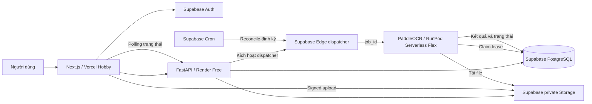
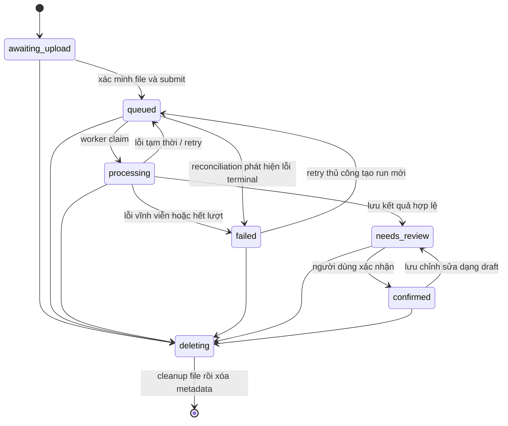

# SmartInvoice AI - Architecture v1.2

Ngày cập nhật: 21/10/2026. Dùng nền tảng Free và **RunPod credit hiện có**, không cần máy cá nhân duy trì OCR. Vercel/Render/Supabase đã deploy; RunPod CPU endpoint đã tạo. [Trạng thái kiểm chứng](verification.md).

## Phạm vi

Đăng ký/đăng nhập, upload hóa đơn, xử lý AI bất đồng bộ, đối chiếu ảnh/PDF với dữ liệu, human review, lịch sử/tìm kiếm và dashboard chi tiêu. Không làm thanh toán, chatbot tài chính, mobile, đồng bộ ngân hàng hoặc train OCR từ đầu trong MVP.

## Kiến trúc được chọn

API không cài PaddleOCR hoặc tải model: giữ container nhẹ cho hosting Free. RunPod queue endpoint dùng API key server-only; browser không gọi RunPod trực tiếp. Không có Cloud Run, Cloud Tasks hoặc LLM API trả phí trong MVP. RunPod là phần compute tính phí bằng credit, tách khỏi ngân sách nền tảng Free.

Queue nghiệp vụ nằm trong PostgreSQL. Serverless worker chỉ chạy khi có job, có thể scale về 0 khi rảnh. Nếu credit hoặc worker không khả dụng, job vẫn tồn tại và UI hiển thị trạng thái chờ/lỗi thật. Dùng dữ liệu mẫu đã ẩn thông tin cá nhân khi demo.

## Luồng upload

1. Frontend đăng nhập bằng Supabase Auth, gửi access token cho FastAPI.
2. API kiểm tra token, lấy `user_id` từ `sub`. Không nhận `user_id` trong body.
3. `POST /receipts` tạo row `awaiting_upload` theo Idempotency-Key, trả ticket cho đường dẫn `{user_id}/{receipt_id}/original.{ext}`.
4. Frontend gọi Supabase `uploadToSignedUrl(path, token, file)`, `upsert=false`. Không tự chọn bucket hoặc storage path.
5. `POST /submit` kiểm tra object thật: kích thước khớp khai báo và <=5 MB, MIME/magic bytes khớp, decode hợp lệ, PDF không mã hóa và <=5 trang, ảnh <=20 triệu pixel, tổng text OCR <=100.000 ký tự. Với PDF, kiểm tra giới hạn render từng trang trước khi tạo ảnh.
6. Backend tính SHA-256 trên bytes thực, lưu metadata đã xác minh. Một transaction khóa receipt, tạo job và outbox, chuyển receipt sang `queued`.
7. Dispatcher gọi RunPod queue API với input `{job_id}`; handler claim job trước khi OCR. File đã upload không được thay thế. Cùng nội dung tải lại thành receipt khác là hành vi được phép; hash chỉ dùng toàn vẹn, không dùng dedupe xuyên người dùng.

Ticket upload có hiệu lực 2 giờ theo Supabase. Replaying create với cùng key chỉ dùng lại một receipt; nếu vẫn `awaiting_upload`, API có thể cấp ticket mới và phải ghi hạn dài nhất trước khi trả về. Sau submit không cấp thêm ticket. Thời hạn chỉ được gia hạn khi còn chờ upload.

## State machine

Sửa `needs_review` và xác nhận lại `confirmed` không cần đổi trạng thái. Mỗi lần UPDATE hợp lệ vẫn tăng `version`. Receipt đã `deleting` không được cập nhật lại.

## Transactions bắt buộc khi triển khai

Database schema, constraints và các command/RPC bên dưới đã triển khai trong migrations; API và worker gọi RPC server-only.

| Command | Những thao tác phải chung transaction |
| --- | --- |
| Submit/retry | Kiểm tra ownership + khóa receipt, tạo job, tạo outbox, cập nhật trạng thái |
| Claim | Khóa receipt rồi job, kiểm tra trạng thái/lease, tăng attempts, cấp fencing token |
| Complete | Kiểm tra token/lease còn hạn + receipt chưa xóa, insert AI result, thay current items/data, chuyển needs_review, hoàn tất job/outbox |
| Review | Kiểm tra ownership/version/state, lưu correction snapshot, thay data/items, validate, cập nhật status/version |
| Delete | Chuyển deleting, hủy job/outbox xử lý, tạo cleanup event |

Luôn khóa theo thứ tự **receipt -> job -> outbox**. Claim theo danh sách dùng `FOR UPDATE SKIP LOCKED`; transaction ngắn, không giữ khóa trong thời gian OCR. Với Supabase Data API, triển khai các command thành RPC chỉ cấp EXECUTE cho server role; nhiều REST calls riêng lẻ không tạo được tính nguyên tử.

## Lease, retry và idempotency

- Mỗi receipt có tối đa một job `pending/running`, enforced bằng unique partial index.
- Một `run_number` là một lần xử lý logic; retry tự động giữ cùng job, tối đa 3 attempts. Retry thủ công sau `failed` tạo run mới.
- Worker lấy một job mỗi lượt, timeout xử lý 240 giây. Lease 360 giây, dùng đồng hồ database.
- Mỗi lần claim tạo `lease_token` UUID mới. Commit chỉ thành công nếu job vẫn running, token khớp và lease chưa hết hạn. Nếu không, rollback toàn bộ dữ liệu result/items/receipt.
- Nếu lỗi network tạm thời: release lease về pending, receipt queued, backoff 5/30/120 giây. Lần cuối ghi failed. Sai định dạng hoặc dữ liệu không hỗ trợ là lỗi terminal, không lặp OCR vô hạn.
- Worker bị kill: lần chạy sau reclaim lease hết hạn; old worker không được commit nhờ token. Không coi outbox `published` là job thành công.
- Dispatcher đọc outbox pending, lưu provider request ID và đánh dấu published khi RunPod nhận việc. Supabase Cron gọi Edge dispatcher theo lịch 5 phút để reconcile; API submit kích hoạt dispatch ngay. Chỉ bật lịch sau khi có cấu hình và secret thật.
- Dispatcher dùng lease riêng để không gửi cùng outbox đồng thời. Timeout khi gửi có thể tạo tình huống provider đã nhận nhưng API chưa lưu ID: không retry liên tục; backoff, tối đa 3 lần gửi tự động rồi ghi lỗi để kiểm tra. Idempotency database ngăn dữ liệu trùng, không bảo đảm RunPod không tính compute cho delivery lặp.
- Reconciler đọc cả provider status lẫn `processing_jobs`; không gửi job thứ hai chỉ vì job đầu còn chờ cấp GPU. Provider success trong khi database chưa commit không được coi là hoàn tất.
- Kết quả lặp lại không insert bản thứ hai vì `extraction_results.job_id` unique.
- Khi provider thiếu compute hoặc hết credit, job có thể thất bại; không tạo kết quả OCR giả. UI polling có backoff 2–30s và dừng sau 15 phút, cho phép kiểm tra lại.

## Xóa dữ liệu

Delete trả `202` sau khi row chuyển `deleting`; API và RLS ẩn receipt, items và lịch sử ngay. Job đang chạy phải kiểm tra lại tombstone khi commit.

Cleanup handler trong Edge dispatcher đợi ít nhất `upload_expires_at + 5 phút` để ticket upload cũ không làm file xuất hiện lại sau khi đã xóa. Sau đó gọi Storage API xóa file, xác nhận object không còn rồi hard-delete receipt và các row con bằng cascade. Cleanup không cần gọi GPU. Không xóa trực tiếp `storage.objects` qua SQL: điều đó không bảo đảm xóa bytes trong object storage.

Preview signed URL có TTL 300 giây, có thể còn dùng được tới hết TTL sau delete. Không phát hành URL mới cho receipt deleting. Nếu dispatcher hoặc Supabase đang tạm dừng, cleanup vật lý chờ lần chạy tiếp theo; dữ liệu vẫn private và bị ẩn khỏi ứng dụng.

## Ownership và credentials

- Browser: publishable key, user session; chỉ đọc row của mình qua RLS, không có quyền sửa bảng trạng thái hay AI result.
- API: server-only Supabase secret/service role; mọi query dùng receipt ID phải lọc thêm `user_id` từ JWT. Server key bypass RLS nên RLS không thay thế authorization trong API.
- RunPod worker: credential server-only; chỉ đọc task ID do dispatcher cung cấp, không nhận URL/path từ browser. V1 giả định worker là thành phần tin cậy do chủ dự án vận hành.
- Schema dùng composite FK để row con không thể gắn với receipt của tenant khác.
- Chỉ API được ghi corrections; AI output gốc cấm UPDATE bằng trigger.
- Không log hóa đơn, token, email, tên file, signed URL hay nội dung lỗi provider có thể chứa dữ liệu gốc.

## Dashboard và monitoring

Analytics mặc định chỉ cộng receipt `confirmed`, nhóm theo `purchase_date` và VND. Ngày mua là calendar date, không tự lấy ngày upload thay thế. Timestamps vận hành lưu UTC; giao diện dùng `Asia/Ho_Chi_Minh`. Danh mục do người dùng chọn, mặc định uncategorized.

API/worker phát JSON logs theo request ID, job ID, stage, duration và error code. Không dùng user ID hoặc job ID làm metric label có cardinality cao. Thống kê queue depth, failed jobs, attempts, OCR/extraction latency và correction rate từ database. Metrics endpoint phải được giới hạn truy cập. Cảnh báo tối thiểu trong UI khi job failed và CI qua GitHub; cloud alerting không là dependency trả phí.

Xem thêm [free deployment](free-deployment.md) và [AI evaluation](ai-output-schema.md#đánh-giá).
