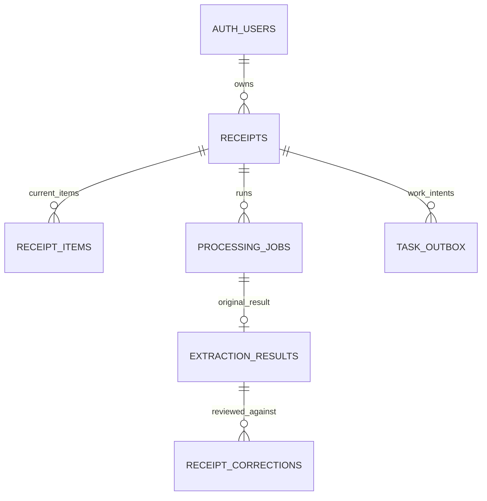

# Database Schema v1.0.0

Migration: `supabase/migrations/20261021022136_smartinvoice_initial_contract.sql`, được tạo tên bằng Supabase CLI. Mục tiêu Supabase PostgreSQL 17. Không chạy migration lên tài khoản thật trong mốc thiết kế này.

## Quan hệ

## Tables

| Table | Vai trò và trường quan trọng |
| --- | --- |
| `auth.users` | Supabase quản lý; không tạo bảng users/password riêng |
| `receipts` | user_id, file metadata, storage_path, SHA-256, status, dữ liệu hiện tại, category, current_extraction_id, version |
| `receipt_items` | Danh sách sản phẩm hiện tại, line_number, quantity/unit_price/line_total có thể null |
| `processing_jobs` | Mỗi run có request_key, attempts, lease_token/expiry, error_code, latency và timestamps |
| `extraction_results` | Một kết quả gốc/job: OCR JSON, extracted JSON, evidence, warnings, timings và pipeline/schema version |
| `receipt_corrections` | Một sự kiện review: before/after snapshot, action, changed_fields, from/to version, AI baseline |
| `task_outbox` | Ý định xử lý hoặc cleanup được tạo cùng transaction với business data |

`receipts.current_extraction_id` dùng composite FK `(receipt_id, user_id, extraction_id)`; không thể trỏ sang hóa đơn hay người dùng khác. Job và các bảng con cũng được ràng buộc ownership bằng composite FK.

## Quy ước kiểu dữ liệu

- IDs: UUID; ID công khai không thay thế việc kiểm tra authorization.
- Tiền: `NUMERIC(16,2)`, không dùng FLOAT. Giới hạn 0 đến 99.999.999.999.999,99; check chặn NaN.
- Quantity: `NUMERIC(12,3)`, >0 hoặc null. Refund/negative invoice không thuộc v1.
- `purchase_date`: DATE. `created_at/processed_at/...`: TIMESTAMPTZ.
- Thiếu thông tin: SQL NULL; không gán 0 hoặc chuỗi rỗng.
- JSONB: dữ liệu gốc và payload có version. Worker phải validate toàn bộ JSON bằng Pydantic trước khi lưu; database không tự kiểm tra sâu toàn bộ JSON Schema.
- Currency v1: VND hoặc null. Hóa đơn tiếng Anh vẫn được đọc nhưng currency ngoài phạm vi phải có warning và review trước.

## Identity và file

Storage path do server tạo, có CHECK khớp user ID, receipt ID và extension canonical. JPEG dùng `.jpg`. User-supplied filename chỉ phục vụ hiển thị; không dùng để tạo path.

ID/owner/path/request hash/MIME/kích thước/filename không được đổi sau create. SHA-256 bất biến sau lần ghi đầu. `upload_expires_at` chỉ được kéo dài khi vẫn awaiting_upload và không được rút ngắn.

Khi queued/processing/needs_review/confirmed, receipt bắt buộc có uploaded_at, SHA-256 và page_count đã xác minh. Quy định byte size thực, signature và số pixel phải thực thi ở API/worker; metadata do browser khai báo không đủ chứng minh file hợp lệ.

## Trạng thái và version

Trigger `guard_receipt_update` kiểm tra các cạnh chuyển trạng thái, tăng version đúng 1 và cập nhật timestamp. API không tự chọn version mới. Mọi review dùng `WHERE id=:id AND user_id=:actor AND version=:expected_version`; không update được row thì trả conflict hoặc not found sau authorization.

`confirmed` bắt buộc có merchant, purchase_date, total_amount, currency, confirmed_at và current_extraction_id. Một warning về tổng tiền không tự sửa số gốc; người dùng có thể xác nhận sau khi kiểm tra và warnings vẫn được lưu.

## Uniqueness và retry

- `(user_id, creation_key)`: create không tạo duplicate receipt.
- `(receipt_id, run_number)`: thứ tự run duy nhất.
- `(user_id, request_key)` trên jobs: retry/submit key không dùng để tạo nhiều job.
- Partial unique `receipt_id WHERE status IN ('pending','running')`: chỉ một job đang hoạt động.
- `extraction_results.job_id`: chỉ một kết quả cuối cho mỗi run.
- `(receipt_id, to_version)` trên corrections: một review event/version.
- Mỗi process job có một outbox event; mỗi receipt có một cleanup event.

Idempotency chỉ bảo vệ thao tác logic; không tự thực hiện enqueue hay retry. Transaction commands và worker lease còn phải được triển khai ở mốc tiếp theo.

## RLS và grants

| Table | anon | authenticated | Server role |
| --- | --- | --- | --- |
| receipts | Không | SELECT own, loại deleting | Ghi qua API với ownership check |
| receipt_items | Không | SELECT own nếu receipt còn hiển thị | Ghi qua transaction |
| receipt_corrections | Không | SELECT own nếu receipt còn hiển thị | Append qua review command |
| processing_jobs | Không | Không trực tiếp | API/worker |
| extraction_results | Không | Không trực tiếp | API/worker; cấm UPDATE |
| task_outbox | Không | Không trực tiếp | Dispatcher/reconciler server-side |

RLS bật trên mọi bảng ứng dụng. Policy dùng `(select auth.uid()) = user_id`. Tránh cấp UPDATE/INSERT trực tiếp cho browser: nếu không người dùng có thể bỏ qua correction history hoặc tự xác nhận job.

Server role là thành phần tin cậy và bypass RLS. API isolation phải được test riêng khi runtime tồn tại. Các function trigger là SECURITY INVOKER với search_path rỗng; không có SECURITY DEFINER RPC công khai trong migration.

## Storage

Bucket `receipts` private, max 5.000.000 byte, MIME allowlist JPEG/PNG/WebP/PDF. Browser chỉ có policy SELECT object khi trùng storage_path của receipt thuộc mình và không deleting. Không cấp policy browser INSERT/UPDATE/DELETE: server phát signed upload capability theo path cố định với upsert=false.

Migration không sửa grant/policy của bucket khác. Với database không phải dự án mới, cần rà soát policy rộng có sẵn vì RLS permissive policies kết hợp bằng OR.

## Indexes

Danh sách theo owner/created_at/id; bộ lọc owner/purchase_date/id và owner/status; analytics partial index cho confirmed, INCLUDE total_amount. FK của tables lớn được index. Merchant substring search dùng ILIKE có escaping `%` và `_`, phạm vi dữ liệu portfolio chưa cần pg_trgm; chỉ thêm khi EXPLAIN/benchmark chứng minh cần.

## Lifecycle

Xóa tài khoản phải cleanup receipt/file trước vì FK tới auth.users là ON DELETE RESTRICT. Xóa receipt sau Storage cleanup sẽ cascade items/jobs/results/corrections/outbox. FK current_extraction là DEFERRABLE để xóa vòng tham chiếu một cách nhất quán trong transaction.

## Kiểm chứng hiện tại

`npm run test:db` áp dụng các application migration trên PGlite, kiểm tra tenant isolation, anonymous access, grants, child ownership, unique active job, stale version, fencing token, state machine, immutable history, tombstone và bucket policy. Auth/Storage schemas trong test là fixtures tối thiểu. Migration pg_cron/pg_net được kiểm tra trên hosted Supabase vì cần background worker. Smoke Supabase thật đã kiểm chứng HTTP Auth/Storage/signed URLs và hai owner; concurrency nhiều connection chưa benchmark.
